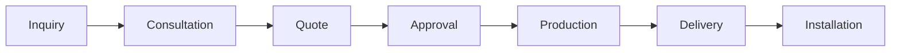

## Overview

This guide explains a typical ordering flow for custom furniture and interior design projects. You can use it as a starter kit template and adapt each step to match your own sales, design, and fulfillment process.

For Diseño Dekora, the journey is intentionally flexible: you start with a conversation, refine the design with guidance, approve the final proposal, and then move into production, delivery, and installation. The goal is to keep the process clear, collaborative, and easy to customize.

<Callout kind="info">

This is sample documentation. Replace the timing, contacts, and approval steps with your own operational details.

</Callout>

## Customer Journey

<Steps>
  <Step title="Initial inquiry" icon="users">
    You begin by sharing your project goals, measurements, preferred finishes, and timeline. A short message is enough to start, but the more context you provide, the faster the team can recommend the right solution.

    Typical inquiry details include room type, approximate dimensions, inspiration photos, and budget range.
  </Step>

  <Step title="Design consultation" icon="book-open">
    In the consultation, you review needs, materials, and style direction with the design team. This is where you align on scope and identify any constraints before moving to a quote.

    If your project has multiple spaces, you can discuss them in a single session or split them into phases.
  </Step>

  <Step title="Quote and approval" icon="check-circle">
    After the consultation, you receive a proposal with the recommended configuration, material notes, and pricing. You review it, request adjustments if needed, and approve the final version once everything is ready.

    Approval should always include the final scope, finish selections, and any agreed deadlines.
  </Step>

  <Step title="Production timeline" icon="package">
    Once approved, the project enters production. This phase usually includes measurement verification, material preparation, fabrication, quality checks, and scheduling.

    A realistic timeline depends on complexity, finish availability, and installation requirements.
  </Step>

  <Step title="Delivery and installation" icon="truck">
    The final stage covers delivery, on-site assembly if required, and a walkthrough to confirm the result. You should verify that the installed product matches the approved design before closing the order.

    Keep a record of any follow-up items so you can resolve them quickly.
  </Step>
</Steps>

## What You Need Before You Start

<Columns cols={3}>
  <Card title="Project details" icon="file-text" href="#customer-journey">
    Share measurements, room photos, and the type of furniture or space you want to improve.
  </Card>

  <Card title="Design preferences" icon="palette" href="#customer-journey">
    Collect favorite colors, finishes, hardware styles, and reference images before the consultation.
  </Card>

  <Card title="Timeline expectations" icon="calendar" href="#customer-journey">
    Define your target date early so the team can plan design, production, and installation milestones.
  </Card>
</Columns>

## Ordering Options

<Tabs>
  <Tab title="Standard order" icon="clipboard-list">

    Use this path when you want a straightforward custom order with one consultation, one quote, and one production cycle.

    It works well for single-room projects and clearly defined requirements.

  </Tab>

  <Tab title="Bespoke project" icon="settings">

    Use this path when the project needs multiple revisions, special materials, or coordinated work across several spaces.

    This option is better when design refinement matters more than speed.

  </Tab>

  <Tab title="Rush timeline" icon="zap">

    Use this path only when your schedule is compressed and production capacity allows priority handling.

    Confirm feasibility before promising dates to the customer.

  </Tab>
</Tabs>

## Example Request Data

This example shows the kind of information a customer might submit during the first step. Keep your own form fields aligned with how your team actually works.

<CodeGroup tabs="JSON,Bash">
  ```json
  {
    "customerName": "Laura Gómez",
    "email": "laura.gomez@example.com",
    "projectType": "Kitchen renovation",
    "city": "Bogotá",
    "budgetRange": "12000-18000",
    "preferredStart": "2026-03-10",
    "notes": "Needs soft-close drawers, warm wood tones, and a compact island."
  }
  ```

  ```bash
  curl -X POST "https://api.example.com/orders" \
    -H "Content-Type: application/json" \
    -d '{
      "customerName": "Laura Gómez",
      "email": "laura.gomez@example.com",
      "projectType": "Kitchen renovation",
      "city": "Bogotá",
      "budgetRange": "12000-18000",
      "preferredStart": "2026-03-10",
      "notes": "Needs soft-close drawers, warm wood tones, and a compact island."
    }'
  ```
</CodeGroup>

## Process Diagram



## Best Practices

- Confirm measurements before you finalize the design.
- Review finishes and hardware with real samples whenever possible.
- Keep communication centralized so the customer knows what happens next.
- Set expectations for lead time early, especially during busy seasons.
- Document approvals in writing to avoid confusion later.

<ExpandableGroup>
  <Expandable title="How many revisions should you allow?" default-open="true" title-type="h3">

    A common approach is to allow one or two revision rounds before approval. That keeps the project moving while still giving the customer room to refine the design.

  </Expandable>

  <Expandable title="What should you include in the quote?" default-open="false" title-type="h3">

    Include the scope of work, material selections, estimated timeline, installation details, and any exclusions. If the customer needs optional upgrades, list them separately.

  </Expandable>

  <Expandable title="What happens after approval?" default-open="false" title-type="h3">

    After approval, you can schedule production, confirm the delivery window, and prepare the installation team. If anything changes, communicate it immediately and update the expected completion date.

  </Expandable>
</ExpandableGroup>

<Callout kind="tip">

If you want to customize this template, start by replacing the timeline, quote format, and approval rules with your own internal process.

</Callout>